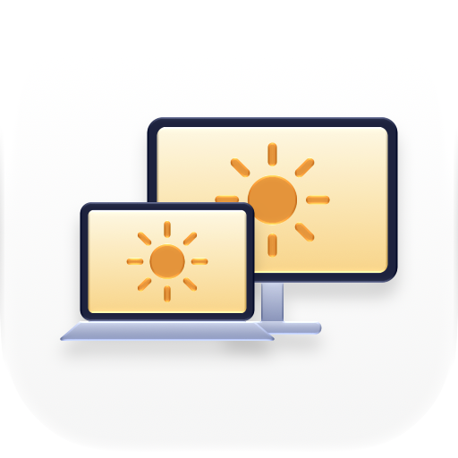
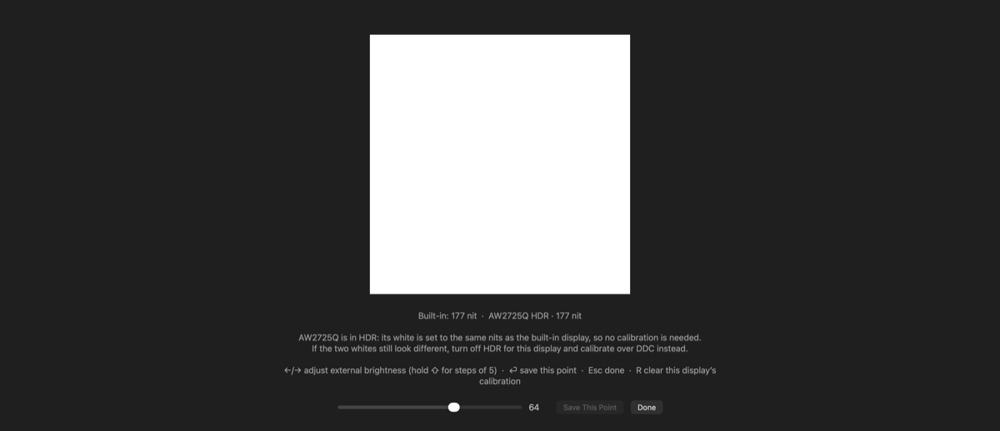
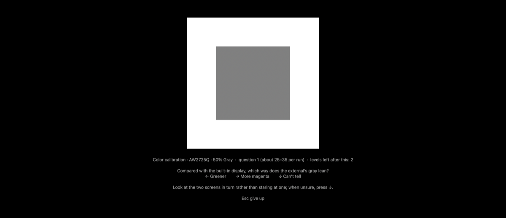

<p align="center">
  <picture>
    <source media="(prefers-color-scheme: dark)" srcset="Icon/AppIcon-dark.png">
    
  </picture>
</p>

<h1 align="center">NitSync</h1>

<p align="center">
  外部ディスプレイの明るさを MacBook の内蔵ディスプレイに追従させます。パーセントではなく nit（輝度）で合わせます。
</p>

<p align="center">
  <a href="README.md">English</a> · <b>日本語</b> · <a href="README.zh-Hans.md">简体中文</a>
</p>

<p align="center">
  
  
  
</p>

---

明るさキーを押したり、コントロールセンターのスライダを動かしたり、明るさの自動調節が働いたりしても、変わるのは MacBook 本体の画面だけです。NitSync は外部ディスプレイを同じなめらかなフェードで追従させ、2 つの画面の明るさをそろえます。メニューバーに常駐し、キー入力の横取りや独自の HUD 表示はしません。

## 特長

- **nit で合わせる** — 内蔵パネルの実際の白の輝度を読み取り、外部ディスプレイを同じ輝度に合わせます。同じパーセントにするのではありません。
- **SDR と HDR の両方に対応** — SDR では DDC/CI でモニタのバックライトを設定します。モニタが DDC を無視する HDR では、macOS が描画する SDR の白の輝度（絶対値の nit）を設定するため、キャリブレーションは不要です。
- **なめらかな追従** — フェードが始まる前に届くシステムの明るさ変更通知で起き、内蔵ディスプレイのカーブに 120 Hz で追従します。アイドル時の CPU 使用率は 0.1 % 未満です。
- **内蔵ディスプレイを基準にしたカラーキャリブレーション** — 外部ディスプレイの白色点、3 段階のグレー（色かぶりと明るさ）、赤・緑・青の原色を目で合わせます。判断のばらつきに強い二択の質問で進めます。
- **ICC プロファイルに保存** — 色の補正は外部ディスプレイ用のプロファイルに書き込まれるため、システム全体に効き、NitSync が起動していなくても有効です。
- **モニタごとに管理** — EDID でモニタを区別するので、ポートを変えても抜き差ししても、それぞれのキャリブレーションが保たれます。
- **多言語対応** — 英語、日本語、簡体字中国語、繁体字中国語。

## 動作環境

- Apple Silicon 搭載の Mac（DDC/CI は Apple Silicon のディスプレイパイプラインを経由します）。
- macOS 14 以降。
- DDC/CI に対応し、オンスクリーンメニューで DDC/CI を有効にした外部ディスプレイ。HDR モードでは、DDC はモニタの検出にだけ使います。

## インストール

[最新のリリース](https://github.com/shiinayane/NitSync/releases/latest)から `NitSync-<バージョン>.zip` をダウンロードして展開し、**NitSync.app** を「アプリケーション」フォルダに移動します。Developer ID で署名され、Apple の公証を受けています。

一度開くと、メニューバーに太陽のアイコンが表示されます。自動で起動させるには、メニューの **ログイン時に開く** を選びます。

## 使い方

メニューには内蔵ディスプレイの現在の輝度と、外部ディスプレイごとの駆動方式が表示されます。**SDR**（送った DDC の値）か **HDR**（SDR の白の輝度、nit）です。

### 明るさのキャリブレーション（SDR のモニタ）

SDR では、NitSync は nit をモニタの DDC の明るさの値に変換する必要があります。キャリブレーションするまでは、モニタの EDID から推定します。

**明るさのキャリブレーション…** を選ぶと、すべての画面の暗い背景に、物理的に同じ大きさの白いパッチが表示されます。

1. 2 つのパッチが同じ明るさに見えるまで ←/→ で調整し、⏎ を押します。
2. 明るさキーで内蔵ディスプレイをはっきり暗くし（画面に目安が表示されます）、もう一度合わせて保存します。
3. Esc を押します。

ポイントの間は nit で補間されます。中間の明るさが合わない場合はポイントを追加してください。HDR のモニタではこの手順は不要です。

<p align="center"></p>

### カラーキャリブレーション

方式の違う 2 つのパネルは、どちらも D65 の白をうたっていても違って見えることがあります。白が合っても、暗いグレーに色かぶりが残ることもあります。カラーキャリブレーションは内蔵ディスプレイを基準に、*あなたの目に*合うよう外部ディスプレイを調整します。

**カラーキャリブレーション…** を選び、次のキーを押します。

| キー | 測るもの | 所要時間 |
|---|---|---|
| **W** | 白: 暖かい/冷たい、緑寄り/マゼンタ寄り | 約 1 分 |
| **G** | 50 %、25 %、12 % のグレー: 色かぶり、白い枠と比べた明るさ | 約 4 分 |
| **P** | sRGB の赤・緑・青: 色相と彩度 | 約 3 分 |

質問はどれも二択です（例:「内蔵ディスプレイと比べて、外部ディスプレイの白はどちら寄りですか？」）。←/→ で答え、違いがわからないときは ↓ を押します。適応的な階段法がランダムな側から一致点へ近づき、質問の間はパッチが暗くなるので色がどちらに動いたかは見えません。回答中に数値は表示されません。各回は保存またはやり直しができ、保存した結果は項目ごとに平均され（最大 5 回）、新しい回は以前の結果と比較されます。⌫ を 2 回押すとカラーキャリブレーションをすべて消去します。

<p align="center"></p>

これは 2 つの画面をあなたの目に合わせるものです。外部ディスプレイを測色的に正確にするわけではなく、それには測色計が必要です。

## しくみ

- **内蔵ディスプレイの輝度** — 内蔵パネルのフレームバッファが SDR の白の輝度を nit で報告します（`IOMFBBrightnessLevel`）。macOS の非公開フレームワーク DisplayServices が明るさの変更前に通知を送り、NitSync のサンプリングを起こします。
- **SDR** — `IOAVService` 経由の DDC/CI でモニタの明るさ（VCP 0x10）を書き込みます。nit からの変換にはキャリブレーションを使います。
- **HDR** — 信号は PQ でエンコードされた絶対輝度なので、モニタは自身の明るさを固定し、SDR の白をどこに置くかは macOS が決めます。NitSync は DisplayServices でその値を設定し、外部ディスプレイのフレームバッファの読み値で補正します。
- **色** — 白とグレーの補正はプロファイルの `vcgt` テーブルに入り、macOS がディスプレイのガンマテーブルに読み込みます。原色はプロファイルの原色座標に入り、カラーマネジメントが使います。プロファイル「<モニタ名> (NitSync)」はディスプレイの出荷時のプロファイルのコピーで、`~/Library/ColorSync/Profiles/NitSync/` に保存されます。

## ソースからのビルド

Xcode のコマンドラインツールが必要です。

```bash
./build.sh
open build/NitSync.app
```

`build.sh` は `swiftc` でコンパイルしてアドホック署名するため、できたアプリは自分の Mac でしか動きません。翻訳は `Localization/translations.json` にあり、ビルド時にそこから `.strings` ファイルを生成します。訳が欠けていたりプレースホルダが一致しなかったりするとビルドは失敗します。アプリのアイコンは Icon Composer のドキュメント（`Icon/AppIcon.icon`）で、`Icon/build-icon.sh` でコンパイル済みのファイルを作り直せます（Xcode 26 以降）。

### リリース

```bash
./release.sh            # 署名、公証、ステープル、dist/ に zip
./release.sh --install  # …さらに /Applications にインストール
```

`release.sh` は、キーチェーンにある最初の Developer ID Application 証明書と、`NitSync` という名前の notarytool のキーチェーンプロファイルを使います。プロファイルは一度だけ作成します。

```bash
xcrun notarytool store-credentials NitSync --apple-id <Apple ID> --team-id <チーム ID>
```

## アンインストール

**ログイン時に開く** をオフにして NitSync を終了します。次に、キャリブレーションしたディスプレイを接続した状態で、カラーキャリブレーションを削除します。各ディスプレイのプロファイルが元に戻り、NitSync のプロファイルが削除されて、アプリはそのまま終了します。

```bash
open -a NitSync --args --reset-color
```

最後に NitSync.app をゴミ箱に入れます。設定は `~/Library/Preferences/local.nitsync.plist` にあります。

## 制限事項

- NitSync は macOS の非公開インターフェイス（`IOAVService`、DisplayServices、フレームバッファのレジストリプロパティ）に依存しています。macOS のアップデートで動かなくなる可能性があります。
- HDR では、macOS が設定できる SDR の白は約 4〜200 nit です。内蔵ディスプレイがそれより明るいと、外部ディスプレイは最大値のままです。
- DDC は遅いため、SDR での追従は約 60 ms ごとの段階的な変化になります。HDR ではなめらかに追従します。
- モニタが明るさを固定するプリセットになっている場合や、ほかのアプリ（Lunar、MonitorControl、BetterDisplay など）も DDC を書き込む場合は、互いに干渉します。ガンマテーブルを書き換えるアプリ（f.lux など）は、白とグレーの補正を上書きします。
- 原色の補正はカラーマネジメントされたコンテンツにだけ効きます。macOS ではほぼすべてですが、ゲームや動画プレーヤーの一部は対象外です。
- カラーキャリブレーションは HDR の外部ディスプレイでしかテストしていません。複数の外部ディスプレイは実機で試していません。

## ライセンス

[MIT](LICENSE)
