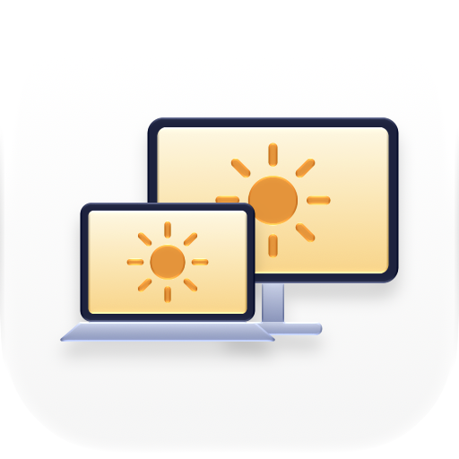

<picture>
  <source media="(prefers-color-scheme: dark)" srcset="Icon/AppIcon-dark.png">
  
</picture>

# NitSync

让外接显示器的亮度跟随 MacBook 内屏，包括亮度键、控制中心和自动亮度。按**亮度（nit）**对齐，不是按百分比对齐。

- 只在菜单栏放一个图标，没有 HUD，不拦截亮度键，不碰系统 OSD。
- 从 IO 注册表读取内屏当前的白场亮度（`disp0` 帧缓冲的 `IOMFBBrightnessLevel`，单位 nit）。
- 自动识别外接屏是 SDR 还是 HDR，菜单里每台显示器后面标出当前模式：
  - **SDR**：通过 DDC/CI 写显示器背光，按校准把 nit 换算成 DDC 值。菜单显示「SDR · DDC 值」。
  - **HDR**：信号是 PQ（绝对亮度），显示器锁定自身亮度、忽略 DDC，由 macOS 决定 SDR 白放在多少 nit，也就是系统设置里那条亮度滑块。NitSync 通过 DisplayServices 设置这个值，并从外接屏帧缓冲读回实际 nit 来修正，让它等于内屏的 nit，不需要校准。菜单显示「HDR · nit」。macOS 能给的 SDR 白范围大约是 4–200 nit，内屏更亮时外接屏停在上限。
- 平滑跟随：内屏亮度变化时（亮度键、控制中心、自动亮度），系统会做约 250 ms 的渐变。NitSync 在变化期间以 60 Hz 采样内屏亮度，让外接屏沿同一条曲线走，平时以 20 Hz 采样。内屏一步跳变时，外接屏会用约 0.2 秒渐变过去。HDR 模式能做到逐帧平滑；SDR 模式受 DDC 速度限制（两次写入间隔至少 60 ms），只能做到每秒十几级。
- 读取外接显示器的 EDID：按型号和序列号区分显示器，菜单里显示型号；HDR 静态元数据里的亮度用于未校准时的估算。
- 合盖或内屏休眠时，外接屏保持当前亮度。
- 唤醒、插拔线、显示器配置变化后会自动重新连接。

## 构建

```bash
./build.sh
open build/NitSync.app
```

需要 Apple Silicon、macOS 14 以上和 Xcode 命令行工具。

应用图标是 Icon Composer 文档 `Icon/AppIcon.icon`，背景交给系统，会随浅色、深色、着色和透明外观变化。改完图标后运行 `Icon/build-icon.sh`（需要 Xcode 26 以上），它会重新生成 `Resources/` 里的 `Assets.car` 和 `AppIcon.icns`，以及 `Icon/` 里的浅色、深色预览图。这些产物已提交，所以平时构建只需要命令行工具。

## 校准

菜单栏图标 → **校准…**

校准时 NitSync 会接管所有屏幕：深灰背景，正中一块白色，内屏和外接屏上的白块物理尺寸相同（约 9 cm，按 EDID 里的屏幕尺寸换算）。

1. 按 ←/→ 调外接屏亮度（按住 ⇧ 每次 5），直到两块白色看起来一样亮，按 ⏎ 保存。也可以用内屏上的滑块和按钮。
2. 用键盘的亮度键把内屏调到明显更暗（屏幕上会给出建议亮度），再对齐、保存一次。
3. 按 Esc 完成。

HDR 模式的显示器不需要校准，校准界面里会说明，调节键对它不起作用。

其他按键：R 连按两次清除当前显示器的校准；接了多台时 Tab 切换要调的那台，没在调的那台白块会变灰。

两个点之间按 nit 线性插值。中间亮度如果仍不一致，可以再补一个点。在相近亮度（±25% 以内）重新保存会覆盖旧的点。

每台显示器各有一套校准，按 EDID 里的厂商、型号和序列号保存，换接口或重新插拔不会丢。

未校准时，按 EDID 中的全屏平均亮度（MaxFALL，没有就用峰值）估算外接屏 100% 时的亮度；EDID 里没有亮度信息时按 250 nit。这些是 HDR 内容的参考值，不是 SDR 白场的实测值，OLED 尤其偏高，所以仍然建议校准。

旧版本保存的单套校准会在第一次启动时迁移给当时连接的第一台显示器。

## 注意

- HDR 模式下按 nit 直接对齐，OLED 大面积白色时显示器自身的亮度限制（ABL）可能让外接屏看起来偏暗；如果更在意准确，可以关掉 HDR，用 DDC 校准。
- HDR 模式下 NitSync 会接管外接屏在系统设置里的亮度滑块，手动拖动后会被拉回和内屏一致；要手动调，先在菜单里关掉「跟随内屏亮度」。
- 不要同时运行 Lunar、MonitorControl、BetterDisplay 等也会写 DDC 的软件。
- 显示器菜单里要开启 DDC/CI，并且不能处在锁定亮度的预设模式下。
- 依赖私有接口（IOAVService，包括 `IOAVServiceCopyEDID`；DisplayServices；IO 注册表属性），系统更新后可能失效。
- 只处理能通过 DDC 找到的外接显示器，HDR 模式也是如此。
- 读不到 EDID 的显示器共用一套校准；同型号且 EDID 里没有序列号的多台显示器也会被当成一台，共用校准和亮度值。

## 许可证

MIT，见 [LICENSE](LICENSE)。
