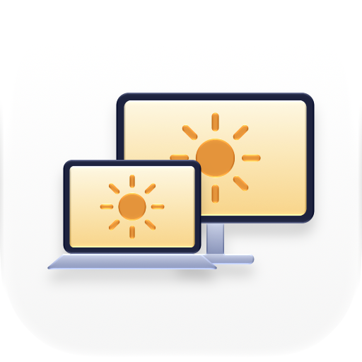
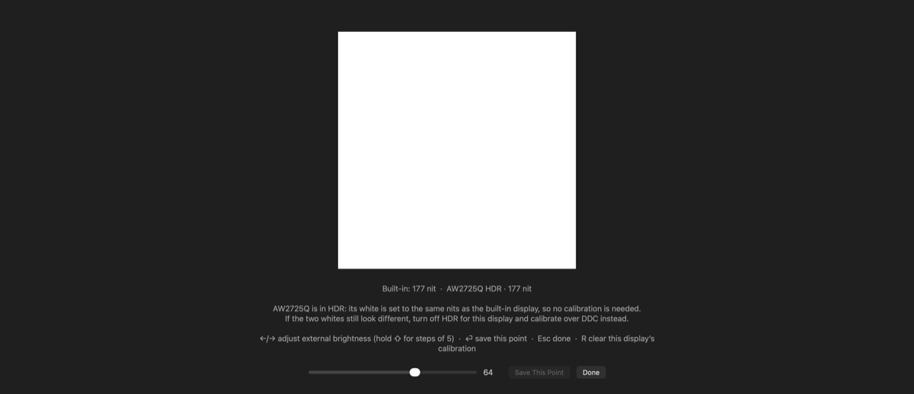
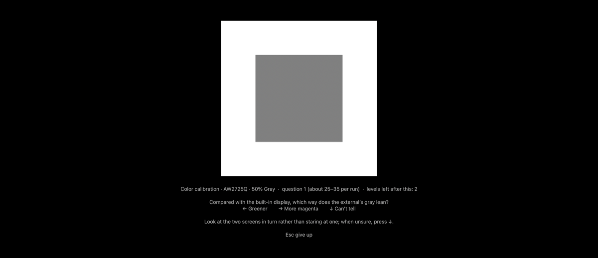

<p align="center">
  <picture>
    <source media="(prefers-color-scheme: dark)" srcset="Icon/AppIcon-dark.png">
    
  </picture>
</p>

<h1 align="center">NitSync</h1>

<p align="center">
  让外接显示器的亮度跟随 MacBook 内屏，按 nit（亮度）对齐，而不是按百分比。
</p>

<p align="center">
  <a href="README.md">English</a> · <a href="README.ja.md">日本語</a> · <b>简体中文</b>
</p>

<p align="center">
  
  
  
</p>

---

按亮度键、拖控制中心的滑块，或者让自动亮度自己调整时，变化的只有 MacBook 本身的屏幕。NitSync 让外接显示器以同样平滑的渐变跟上，让两块屏一样亮。它只在菜单栏放一个图标，不拦截按键，也不显示自己的 HUD。

## 功能

- **按 nit 对齐**：读取内屏实际的白场亮度，把外接显示器调到同样的亮度，而不是同样的百分比。
- **支持 SDR 和 HDR 显示器**：SDR 下通过 DDC/CI 调显示器背光。HDR 下显示器会忽略 DDC，NitSync 改为设置 macOS 渲染的 SDR 白电平；它本身就是绝对 nit，不需要校准。
- **平滑跟随**：系统在亮度渐变开始前会发出通知，NitSync 收到后以 120 Hz 沿内屏的渐变曲线跟随。闲置时 CPU 占用不到 0.1%。
- **以内屏为参考的颜色校准**：用眼睛对齐外接屏的白点、三档灰阶（色偏和明暗）以及红绿蓝原色。采用二选一提问，不怕单次判断的误差。
- **保存在 ICC 描述文件里**：颜色校正写进外接显示器的描述文件，对整个系统生效，不开 NitSync 也一直有效。
- **按显示器区分**：用 EDID 区分显示器，换接口、重新插拔都保留各自的校准。
- **多语言**：英文、日文、简体中文、繁体中文。

## 系统要求

- 搭载 Apple Silicon 的 Mac（DDC/CI 走 Apple Silicon 的显示通路）。
- macOS 14 或更高版本。
- 支持 DDC/CI 的外接显示器，并在显示器菜单里开启 DDC/CI。HDR 模式下，DDC 只用来识别显示器。

## 安装

从[最新版本](https://github.com/shiinayane/NitSync/releases/latest)下载 `NitSync-<版本>.zip`，解压后把 **NitSync.app** 拖进「应用程序」。应用已用 Developer ID 签名并通过 Apple 公证。

打开一次后，菜单栏会出现太阳图标。在菜单里勾选 **登录时启动** 即可开机自动运行。

## 使用

菜单里会显示内屏当前的亮度，以及每台外接显示器的驱动方式：**SDR**（发送的 DDC 值）或 **HDR**（SDR 白电平，单位 nit）。

### 亮度校准（SDR 显示器）

SDR 下，NitSync 需要把 nit 换算成显示器的 DDC 亮度值。校准之前，它按显示器的 EDID 估算。

选择 **亮度校准…**，所有屏幕都会在深色背景上显示物理尺寸相同的白块：

1. 按 ←/→ 调到两块白色看起来一样亮，按 ⏎ 保存。
2. 用亮度键把内屏调到明显更暗（屏幕上会给出建议亮度），再对齐、保存一次。
3. 按 Esc 完成。

校准点之间按 nit 插值；中间亮度仍不一致时可以再补一个点。HDR 显示器不需要这一步。

<p align="center"></p>

### 颜色校准

两块发光技术不同的屏幕，即使都标称 D65 白点，看上去也可能不一样；白色对上之后，暗灰也可能仍然偏色。颜色校准以内屏为参考，按*你的眼睛*看到的效果调整外接屏。

选择 **颜色校准…**，然后按：

| 按键 | 校准内容 | 用时 |
|---|---|---|
| **W** | 白色：冷暖、偏绿/偏紫红 | 约 1 分钟 |
| **G** | 50%、25%、12% 三档灰：色偏，以及对照白框的明暗 | 约 4 分钟 |
| **P** | sRGB 的红、绿、蓝：色相和饱和度 | 约 3 分钟 |

每道题都是二选一（例如「和内屏比，外屏的白色更偏哪边？」），用 ←/→ 回答，看不出差别就按 ↓。自适应阶梯法从随机的一侧逼近匹配点；题与题之间色块会熄灭，你看不到颜色往哪边变；答题过程中不显示任何数值。每一轮都可以保存或重测，保存的结果按项目分别取平均（每项最多 5 轮），新的一轮会和之前的结果比较。连按两次 ⌫ 清除全部颜色校准。

<p align="center"></p>

这样做是让两块屏在你眼里一致，而不是让外接屏达到标准色彩；后者需要色度计。

## 原理

- **内屏亮度**：内屏帧缓冲上报的 SDR 白电平，单位 nit（`IOMFBBrightnessLevel`）。macOS 的私有框架 DisplayServices 会在亮度变化开始前发出通知，唤醒 NitSync 的采样。
- **SDR**：通过 `IOAVService` 走 DDC/CI 写显示器亮度（VCP 0x10），按你的校准从 nit 换算。
- **HDR**：信号是 PQ 编码的绝对亮度，显示器锁定自身亮度，SDR 白放在多少 nit 由 macOS 决定。NitSync 通过 DisplayServices 设置这个值，并根据外接屏帧缓冲的读数修正。
- **颜色**：白点和灰阶校正写进描述文件的 `vcgt` 表，由 macOS 载入显示器的色调表；原色写进描述文件的原色坐标，由色彩管理使用。描述文件名为「<显示器名> (NitSync)」，复制自显示器的出厂描述文件，存放在 `~/Library/ColorSync/Profiles/NitSync/`。

## 从源码构建

需要 Xcode 命令行工具。

```bash
./build.sh
open build/NitSync.app
```

`build.sh` 用 `swiftc` 编译并做临时签名，构建结果只能在本机运行。翻译放在 `Localization/translations.json`，构建时由它生成 `.strings` 文件；缺少译文或占位符不一致时构建会失败。应用图标是 Icon Composer 文档（`Icon/AppIcon.icon`），用 `Icon/build-icon.sh` 重新生成编译产物（需要 Xcode 26 以上）。

### 发布

```bash
./release.sh            # 签名、公证、装订票据、打包到 dist/
./release.sh --install  # ……并安装到「应用程序」
```

`release.sh` 使用钥匙串里的第一个 Developer ID Application 证书，以及名为 `NitSync` 的 notarytool 钥匙串配置。这个配置只需创建一次：

```bash
xcrun notarytool store-credentials NitSync --apple-id <Apple ID> --team-id <团队 ID>
```

## 卸载

先关掉 **登录时启动** 并退出 NitSync。然后在校准过的显示器都连接着的情况下清除颜色校准：它会把各显示器换回原来的描述文件，删除 NitSync 的描述文件，然后自动退出。

```bash
open -a NitSync --args --reset-color
```

最后把 NitSync.app 移到废纸篓。设置保存在 `~/Library/Preferences/local.nitsync.plist`。

## 局限

- NitSync 依赖 macOS 的私有接口（`IOAVService`、DisplayServices、帧缓冲的注册表属性），系统更新后可能失效。
- HDR 下 macOS 能给的 SDR 白约在 4–200 nit 之间；内屏更亮时，外接屏停在上限。
- DDC 速度慢，SDR 下的跟随大约每 60 ms 一级，能看出台阶；HDR 下是平滑的。
- 显示器处在锁定亮度的预设模式，或者有其他软件（Lunar、MonitorControl、BetterDisplay 等）也在写 DDC 时，会互相干扰。改写色调表的软件（f.lux 等）会覆盖白点和灰阶校正。
- 原色校正只影响经过色彩管理的内容，macOS 上几乎都是，但个别游戏、播放器除外。
- 颜色校准只在 HDR 外接显示器上测试过；多台外接显示器还没在实机上测试过。

## 许可证

[MIT](LICENSE)
